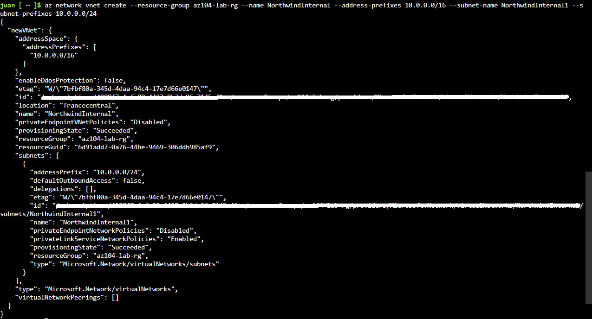
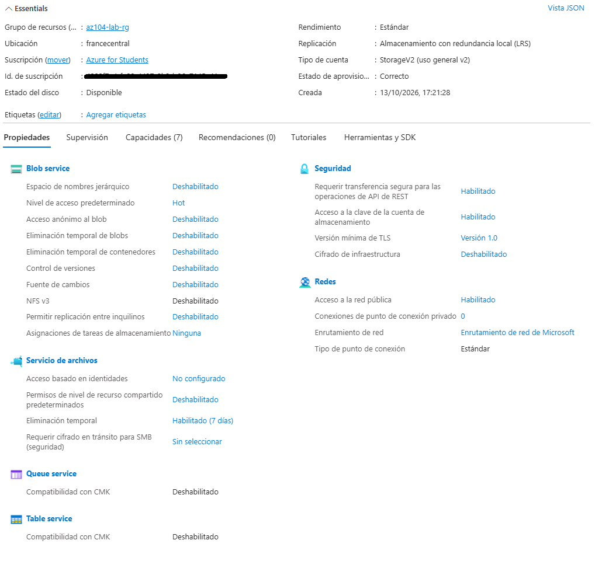
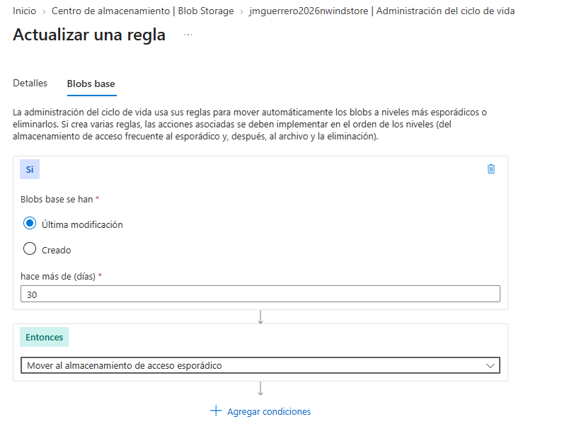
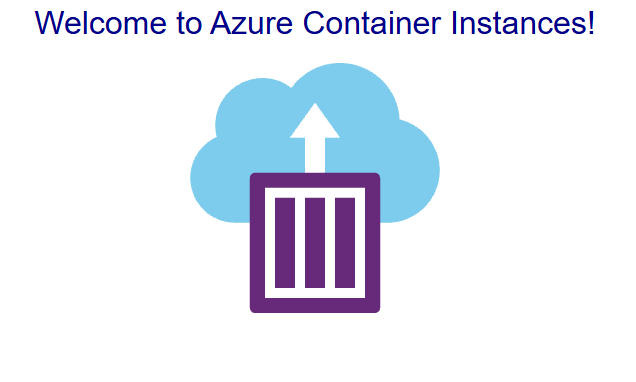

### 🛡️ Custom Challenge: Arquitectura Serverless y Almacenamiento Estático Seguro (VNet, CaaS & PaaS)
**Objetivo:** Diseñar e implementar una arquitectura en la nube para alojar aplicaciones web y contenido estático minimizando los costes operativos. Se integran servicios de contenedores sin servidor, segmentación de red base y automatización del ciclo de vida de los datos (FinOps).

#### 1. Segmentación y Red Base (VNet)
Para sentar las bases de una topología de red escalable y controlada, se implementó un entorno de red virtualizado:
- **Contención y Gobernanza:** Se provisionó un Grupo de Recursos dedicado en la región `France Central` junto con alertas preventivas de presupuesto para evitar sobrecostes inesperados.
- **Espacio de Direccionamiento:** Se desplegó la red virtual (`NorthwindInternal`) con un bloque CIDR `10.0.0.0/16` y una subred inicial (`10.0.0.0/24`), reservando estrictamente las direcciones IP requeridas por la arquitectura interna de Azure.

#### 2. Almacenamiento Estático y Seguridad Perimetral (Storage Account)
Para los activos estáticos de la aplicación, se descartó el uso de servidores de archivos tradicionales a favor de Azure Blob Storage:
- **Prevención de Fugas de Datos (Zero Trust):** Se bloqueó categóricamente el acceso público anónimo a nivel de la cuenta de almacenamiento. El contenedor (`estaticos`) fuerza la autenticación centralizada.
- **Redundancia Económica:** Se configuró la cuenta con redundancia local (LRS), manteniendo 3 copias síncronas de los datos dentro del mismo centro de datos físico para optimizar el gasto operativo.

#### 3. Automatización de Costes - FinOps (Lifecycle Management)
Se implementó una política automatizada para maximizar el ahorro financiero en el almacenamiento a largo plazo:
- **Transición de Niveles de Acceso:** Se creó una regla lógica que audita continuamente la actividad de los blobs. Si un archivo no sufre modificaciones durante 30 días, el motor de Azure lo transiciona automáticamente del nivel Frecuente (Hot) al nivel Esporádico (Cool), reduciendo drásticamente el coste mensual por gigabyte.

#### 4. Procesamiento Efímero (CaaS - Azure Container Instances)
La lógica principal de la aplicación web se alojó utilizando un servicio de contenedores puro (Serverless), evitando la sobrecarga operativa y de parcheo que exigen las Máquinas Virtuales (IaaS):
- **Despliegue Ágil:** Se instanció un contenedor Linux consumiendo directamente una imagen Docker pública, asignando recursos exactos (1 vCPU y 1.5 GB de RAM) que se facturan por segundo de ejecución.
- **Exposición Controlada:** El microservicio fue expuesto al exterior a través del puerto 80, asociándole una etiqueta DNS pública única (`FQDN`) para permitir el acceso web directo desde cualquier navegador.

--------------------------------------------------------------------------------

*Laboratorio completado. La infraestructura asegura el control de costes mediante servicios serverless, blinda el almacenamiento contra accesos no autorizados y automatiza la eficiencia financiera de los datos estáticos.*